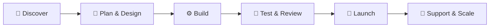

  

  

  

<a href="#about"><b>About</b></a> &nbsp;•&nbsp;
<a href="#services"><b>Services</b></a> &nbsp;•&nbsp;
<a href="#stack"><b>Tech Stack</b></a> &nbsp;•&nbsp;
<a href="#process"><b>Process</b></a> &nbsp;•&nbsp;
<a href="#why"><b>Why Us</b></a> &nbsp;•&nbsp;
<a href="#github"><b>GitHub</b></a> &nbsp;•&nbsp;
<a href="#faq"><b>FAQ</b></a> &nbsp;•&nbsp;
<a href="#contact"><b>Contact</b></a>

<h2 align="center" id="about">✦ About Us ✦</h2>

<b>DevCore Solutions</b> is a full-stack software agency based in <b>Chattogram, Bangladesh</b>. 
We turn complex ideas into fast, secure, and scalable web applications, 
from the first wireframe to production deployment and beyond.

We pair modern engineering practices with clean design and practical AI 
to help startups, businesses, and entrepreneurs launch products that last.

> 💡 **Our Mission:** Build reliable, high-performance software that gives our clients a real competitive edge.

 

<h2 align="center" id="services">✦ What We Do ✦</h2>

<table align="center" width="100%">
<tr>
<td width="33%" valign="top">
<h3>🌐 Web Applications</h3>

Production-grade SaaS platforms, dashboards, portals, and marketplaces built on modern frameworks.

</td>
<td width="33%" valign="top">
<h3>🎨 UI/UX &amp; Frontend</h3>

Responsive, accessible, pixel-perfect interfaces that look great on every device and convert visitors into customers.

</td>
<td width="33%" valign="top">
<h3>🛒 E-Commerce &amp; Business</h3>

Scalable storefronts, booking systems, and management tools tailored to your workflow.

</td>
</tr>
<tr>
<td width="33%" valign="top">
<h3>🤖 AI Integrations</h3>

Chatbots, automation, content generation, and intelligent workflows added to your product.

</td>
<td width="33%" valign="top">
<h3>🗄️ Backend &amp; APIs</h3>

Secure REST APIs, authentication, payment and third-party integrations, and well-structured PostgreSQL databases.

</td>
<td width="33%" valign="top">
<h3>☁️ Deployment &amp; Support</h3>

CI/CD pipelines, cloud deployment, performance tuning, and ongoing maintenance so your product stays fast and online.

</td>
</tr>
</table>

 

<h2 align="center" id="stack">✦ Tech Stack ✦</h2>

 

  

| Layer | Technologies |
|:------|:-------------|
| **Frontend** | Next.js · React · TypeScript · Tailwind CSS |
| **Backend** | Node.js · REST APIs · Server Actions |
| **Database** | PostgreSQL · Prisma ORM |
| **AI** | LLM APIs · Automation · Smart Integrations |
| **Deployment** | Vercel · Netlify · Docker · CI/CD |

 

<h2 align="center" id="process">✦ How We Work ✦</h2>

| Step | What Happens |
|:----:|:-------------|
| **01 · Discover** | We learn your goals, users, and requirements. |
| **02 · Plan & Design** | Architecture, wireframes, and a clear roadmap. |
| **03 · Build** | Agile development with regular progress updates. |
| **04 · Test & Review** | Quality checks, performance, and security review. |
| **05 · Launch** | Smooth deployment to production. |
| **06 · Support & Scale** | Monitoring, maintenance, and new features as you grow. |

 

<h2 align="center" id="why">✦ Why DevCore? ✦</h2>

<table align="center" width="100%">
<tr>
<td width="33%" valign="top">
<h3>⚡ Modern Stack</h3>

Next.js, TypeScript, and PostgreSQL for speed and long-term maintainability.

</td>
<td width="33%" valign="top">
<h3>🧱 Clean, Scalable Code</h3>

Built to grow with your business.

</td>
<td width="33%" valign="top">
<h3>🤖 AI-Ready</h3>

Practical AI features integrated where they add real value.

</td>
</tr>
<tr>
<td width="33%" valign="top">
<h3>🔍 Transparent Communication</h3>

Clear timelines, honest updates, no surprises.

</td>
<td width="33%" valign="top">
<h3>🎯 End-to-End Delivery</h3>

Design, development, deployment, and support under one roof.

</td>
<td width="33%" valign="top">
<h3>🤝 Client-First Mindset</h3>

Your success is our success.

</td>
</tr>
</table>

 

<h2 align="center" id="engagement">✦ Engagement Models ✦</h2>

<table align="center" width="100%">
<tr>
<td width="25%" valign="top" align="center">
<h3>📦 Fixed-Price</h3>

Well-defined scope with a clear deliverable.

</td>
<td width="25%" valign="top" align="center">
<h3>👨‍💻 Dedicated Developers</h3>

Long-term products needing ongoing development.

</td>
<td width="25%" valign="top" align="center">
<h3>⏱️ Hourly / Flexible</h3>

Evolving requirements and quick support.

</td>
<td width="25%" valign="top" align="center">
<h3>🚀 MVP Package</h3>

Startups launching their first version fast.

</td>
</tr>
</table>

 

<h2 align="center" id="github">✦ GitHub Activity ✦</h2>

  

 

  

 

<h2 align="center" id="faq">✦ FAQ ✦</h2>

<b>What kind of projects do you take on?</b>

 
SaaS platforms, dashboards, portals, marketplaces, e-commerce and booking systems, plus AI-powered features for existing products.
  

<b>Do you work with international clients?</b>

 
Yes. We are based in Chattogram, Bangladesh and collaborate with clients remotely through email, WhatsApp, and video calls.
  

<b>How do we start a project?</b>

 
Send us a short brief by email or WhatsApp. We will schedule a free consultation to discuss goals, scope, and the best engagement model for you.
  

<b>Do you offer support after launch?</b>

 
Yes. We provide monitoring, maintenance, performance tuning, and new feature development as your product grows.
  

<b>Which technologies do you use?</b>

 
Primarily Next.js, React, TypeScript, Tailwind CSS, Node.js, PostgreSQL, and Prisma, deployed on Vercel, Netlify, or Docker-based infrastructure.
  

 

<h2 align="center" id="contact">✦ Let's Build Something Great Together ✦</h2>

Have a project in mind? We'd love to hear about it.

  

| | Contact |
|:--:|:--|
| 📧 **Email** | [dev.core.solution2@gmail.com](mailto:dev.core.solution2@gmail.com) |
| 📱 **Phone / WhatsApp** | [+880 1766-140126](tel:+8801766140126) |
| 📍 **Location** | Chattogram, Bangladesh |
| 💼 **LinkedIn** | [linkedin.com/company/devcoresolutions2](https://www.linkedin.com/company/devcoresolutions2) |
| 📘 **Facebook** | [facebook.com/devcoresolutionsofficial](https://www.facebook.com/devcoresolutionsofficial) |
| 📸 **Instagram** | [instagram.com/devcoresolutionsofficial](https://www.instagram.com/devcoresolutionsofficial/) |
| 🐦 **X (Twitter)** | [@DevCoreSolution](https://x.com/DevCoreSolution) |
| ▶️ **YouTube** | [@DevCoreSolutionsOfficial](https://www.youtube.com/@DevCoreSolutionsOfficial) |
| 👽 **Reddit** | [u/DevCoreSolutions2](https://www.reddit.com/user/DevCoreSolutions2/) |

 

  

**© 2026 DevCore Solutions. All rights reserved.**
*Built with ❤️ in Chattogram, Bangladesh*

