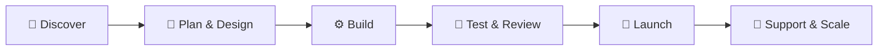

  

 

## ✦ About Us

**DevCore Solutions** is a full-stack software agency based in **Chattogram, Bangladesh**. We turn complex ideas into fast, secure, and scalable web applications, from the first wireframe to production deployment and beyond.

We pair modern engineering practices with clean design and practical AI to help startups, businesses, and entrepreneurs launch products that last.

> **Our Mission:** Build reliable, high-performance software that gives our clients a real competitive edge.

 

## ✦ What We Do

<table>
  <tr>
    <td width="33%" valign="top">

#### 🌐 Web Applications
Production-grade SaaS platforms, dashboards, portals, and marketplaces built on modern frameworks.

    </td>
    <td width="33%" valign="top">

#### 🎨 UI/UX & Frontend
Responsive, accessible, pixel-perfect interfaces that look great on every device and convert visitors into customers.

    </td>
    <td width="33%" valign="top">

#### 🛒 E-Commerce & Business
Scalable storefronts, booking systems, and management tools tailored to your workflow.

    </td>
  </tr>
  <tr>
    <td width="33%" valign="top">

#### 🤖 AI Integrations
Chatbots, automation, content generation, and intelligent workflows added to your product.

    </td>
    <td width="33%" valign="top">

#### 🗄️ Backend & APIs
Secure REST APIs, authentication, payment and third-party integrations, and well-structured PostgreSQL databases.

    </td>
    <td width="33%" valign="top">

#### ☁️ Deployment & Support
CI/CD pipelines, cloud deployment, performance tuning, and ongoing maintenance so your product stays fast and online.

    </td>
  </tr>
</table>

 

## ✦ Tech Stack

 

| Layer | Technologies |
|:------|:-------------|
| **Frontend** | Next.js · React · TypeScript · Tailwind CSS |
| **Backend** | Node.js · REST APIs · Server Actions |
| **Database** | PostgreSQL · Prisma ORM |
| **AI** | LLM APIs · Automation · Smart Integrations |
| **Deployment** | Vercel · Netlify · Docker · CI/CD |

 

## ✦ How We Work

| Step | What Happens |
|:----:|:-------------|
| **01 · Discover** | We learn your goals, users, and requirements. |
| **02 · Plan & Design** | Architecture, wireframes, and a clear roadmap. |
| **03 · Build** | Agile development with regular progress updates. |
| **04 · Test & Review** | Quality checks, performance, and security review. |
| **05 · Launch** | Smooth deployment to production. |
| **06 · Support & Scale** | Monitoring, maintenance, and new features as you grow. |

 

## ✦ Why DevCore?

| | |
|:--|:--|
| ⚡ **Modern Stack** | Next.js, TypeScript, and PostgreSQL for speed and long-term maintainability. |
| 🧱 **Clean, Scalable Code** | Built to grow with your business. |
| 🤖 **AI-Ready** | Practical AI features integrated where they add real value. |
| 🔍 **Transparent Communication** | Clear timelines, honest updates, no surprises. |
| 🎯 **End-to-End Delivery** | Design, development, deployment, and support under one roof. |
| 🤝 **Client-First Mindset** | Your success is our success. |

 

## ✦ Engagement Models

| Model | Best For |
|:------|:---------|
| **Fixed-Price Project** | Well-defined scope with a clear deliverable |
| **Dedicated Developer(s)** | Long-term products needing ongoing development |
| **Hourly / Flexible** | Evolving requirements and quick support |
| **MVP Package** | Startups launching their first version fast |

 

## ✦ Let's Build Something Great Together

Have a project in mind? We'd love to hear about it.

  

| | Contact |
|:--:|:--|
| 📧 **Email** | [dev.core.solution2@gmail.com](mailto:dev.core.solution2@gmail.com) |
| 📱 **Phone / WhatsApp** | [+880 1766-140126](tel:+8801766140126) |
| 📍 **Location** | Chattogram, Bangladesh |

 

## ✦ Find Us Online

| Platform | Link |
|:--------:|:-----|
| 💼 **LinkedIn** | [linkedin.com/company/devcoresolutions2](https://www.linkedin.com/company/devcoresolutions2) |
| 📘 **Facebook** | [facebook.com/devcoresolutionsofficial](https://www.facebook.com/devcoresolutionsofficial) |
| 📸 **Instagram** | [instagram.com/devcoresolutionsofficial](https://www.instagram.com/devcoresolutionsofficial/) |
| 🐦 **X (Twitter)** | [@DevCoreSolution](https://x.com/DevCoreSolution) |
| ▶️ **YouTube** | [@DevCoreSolutionsOfficial](https://www.youtube.com/@DevCoreSolutionsOfficial) |
| 👽 **Reddit** | [u/DevCoreSolutions2](https://www.reddit.com/user/DevCoreSolutions2/) |
| ✉️ **Email** | [dev.core.solution2@gmail.com](mailto:dev.core.solution2@gmail.com) |

 

  

**© 2026 DevCore Solutions. All rights reserved.**
*Built with ❤️ in Chattogram, Bangladesh*

